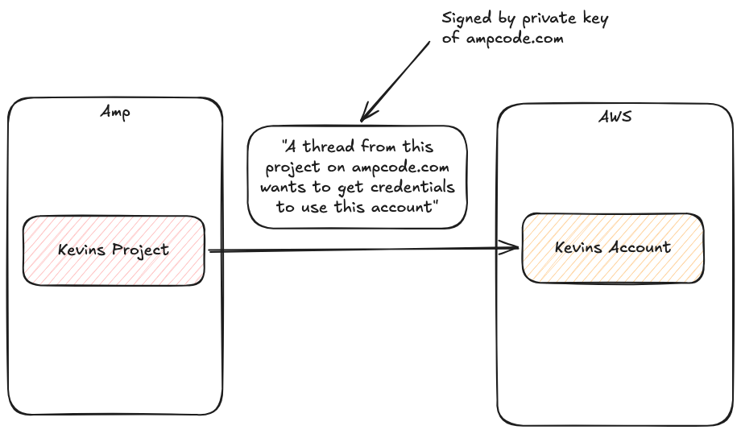
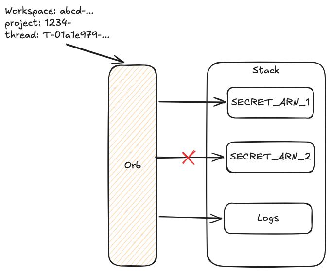
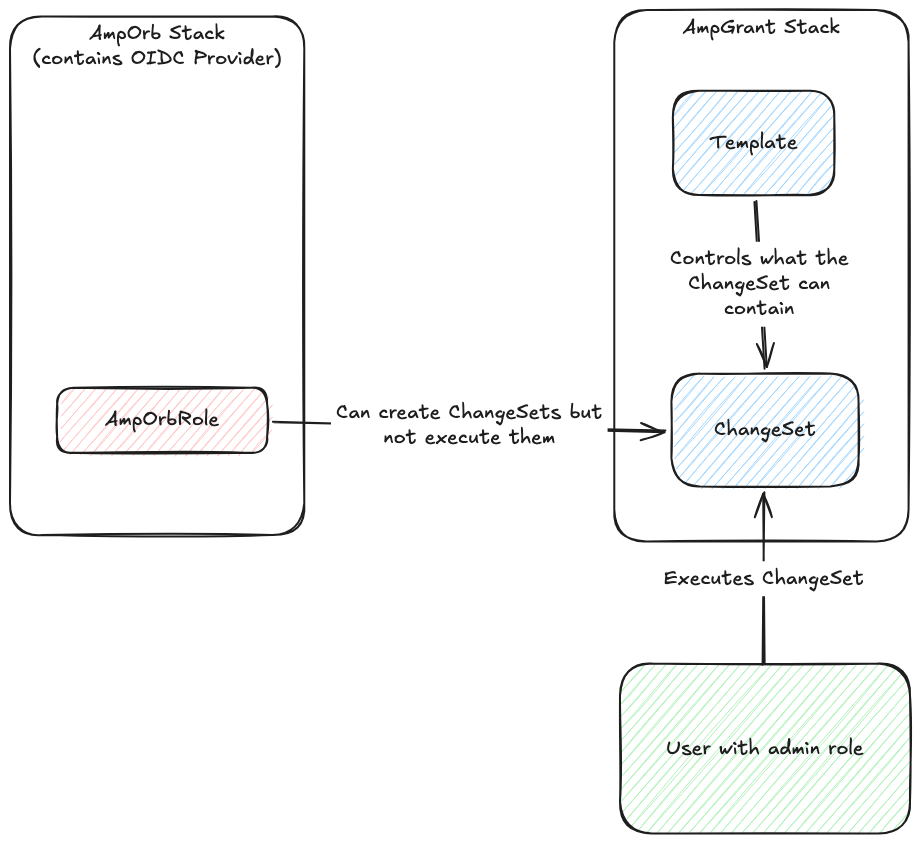
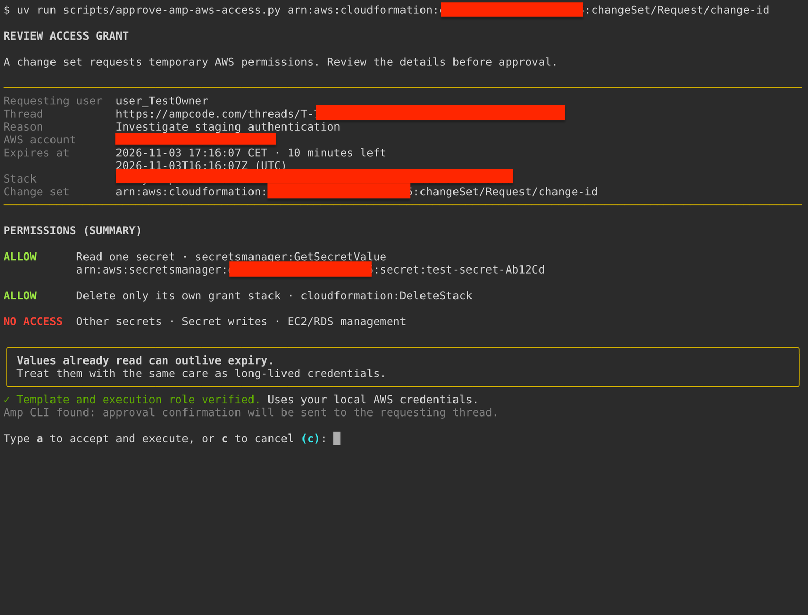
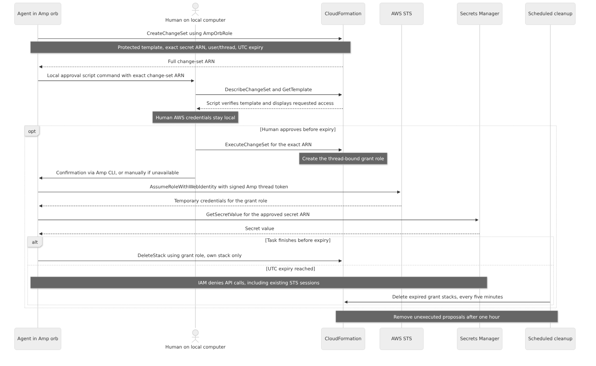

This post explains how I use Amp’s OIDC integration with AWS to give an orb temporary elevated access to one secret. The orb requests the grant, and I approve it locally.

<!--more-->

## Looking for a sandbox

This all started when I was looking for a way to properly sandbox the AWS access my agent has.

When I work locally on my MacBook, I select the correct role (mostly read-only or admin) using [awsume](https://awsu.me/).

In my setup, awsume uses a cached SSO token to switch between AWS accounts and roles. This means an agent doesn't need long to find out that if the AWS role it is using prevents it from completing a task, it can find this SSO token and a(w)sume a different role with more access.
Every thought of sandboxing this by writing wrappers, extensions, and rules led me back to the fact that to be 100% sure that the agent cannot do this it can't run on my machine as my user.

I looked into [docker sbx](https://www.docker.com/products/docker-sandboxes/) but was afraid of the additional work needed to give these sandboxes access to the AWS roles I need. I figured at the very least I would have to write a broker between the sandbox and my host running awsume. I didn't want to maintain that.

That’s when I gave [Amp orbs](https://ampcode.com/notes/orbs-explained) a try. I won't explain what orbs are, because it’s very hard unless you have experienced it yourself. I will only say that running each agent thread/session on a dedicated machine where it can do whatever it wants and I have full control over its access is a game changer.

## OIDC in Amp Orbs

One of the ways to give Amp orbs access to your system is using [OIDC](https://openid.net/developers/how-connect-works/). This allows me to establish a trust relationship between my Amp projects and my AWS accounts. Following the [Amp doc](https://ampcode.com/docs/orbs/handling-secrets#oidc) I can set up where Amp should send its requests and on the AWS side I can configure what permissions I want to give. Amp signs the OIDC ID token with its private key. AWS uses Amp’s published public keys to verify the signature, then checks the token against the role’s trust policy.




The sub claim value that Amp sends looks like the following.
```code
workspace:<workspace-id>:project:<project-id>:user:<user-id>:thread:<thread-id>
```
This means the claim comes from my workspace, in this workspace from a specific project, with my user ID and also from a specific thread.
This gives me four levels of access I can give:

- To my whole workspace (company/team)
- To every thread in the project
- To every thread in the project by me
- To a single thread

Thread-specific access is the focus of this post, but first we will look at the general CDK setup:

```typescript
const issuer = "ampcode.com/api/workload-identity";
const audienceId = "kevins-project"; // chosen by me
const audience = `urn:amp:aws:${audienceId}:${this.account}`;
const ampWorkspaceId = "ab345ab0-1234-abcd-2dbc-e5cd35abc23f";
const ampProjectId = "cf343bc1-2345-cdef-3abc-e2cd35abc23f";
const subject = `workspace:${ampWorkspaceId}:project:${ampProjectId}`;

const provider = new iam.CfnOIDCProvider(this, "AmpOidcProvider", {
      url: `https://${issuer}`,
      clientIdList: [audience],
    });

const role = new iam.Role(this, "AmpOrbRole", {
  roleName: "AmpOrbRole",
  description: "AWS access for Amp Orbs",
  maxSessionDuration: Duration.hours(1),
  assumedBy: new iam.FederatedPrincipal(
    provider.ref,
    { StringEquals: { [`${issuer}:aud`]: audience,[`${issuer}:sub`]:subject } },
        "sts:AssumeRoleWithWebIdentity",
  ),
  managedPolicies: [iam.ManagedPolicy.fromAwsManagedPolicyName("ReadOnlyAccess")],
});

role.addToPolicy(
  new iam.PolicyStatement({
    actions: ["secretsmanager:GetSecretValue"],
    resources: ["SECRET_ARN_1"],
  }),
);
```

This sets up an OIDC integration on the AWS side meaning[^amp-oidc-setup]:

```
If a claim from this specific project on Amp arrives we let it assume the AmpOrbRole which has broad read-only access across AWS services and additionally access to the secret value of SECRET_ARN_1
```



This is enough for my agent’s everyday work. It can see all the logs and use the secret to e.g. access the staging instance of my service.

## Temporary elevated access

Sometimes this access isn't enough, maybe I want to give a debug thread access to the credentials to the production instance.

This is where we can make use of the fact that each thread has a unique ID. Building on the CDK construct shown above, we can give this specific thread an additional permission.

I grant the existing `AmpOrbRole` the permission to **create** new change sets but not **execute** them. This means the agent can suggest additional permissions but it cannot grant those permissions to itself. Only a role with the permissions to execute the change set, like my admin role, can do that.


Additional constraints I put in place:

- The agent must use a fixed template to create the change set. This restricts what the agent can request.
- Executing the change set creates a new CloudFormation stack containing the grant role and its permissions. The agent has the permission to delete this stack so it can clean up after itself.
- The permissions granted in these new stacks are limited to 30 minutes. After that they cannot be used anymore. This does not mean the secret values themselves aren't valid anymore. This is also only an instruction to the agent and must be verified by the Python script mentioned below or manually.
- A scheduled Lambda function that detects stacks that haven't been cleaned up by the agent and deletes them.

<details markdown="block">
<summary>The additional CDK stack</summary>

```typescript
export class AmpGrantControlStack extends cdk.Stack {
  constructor(scope: Construct, id: string, props: cdk.StackProps) {
    super(scope, id, props);

    const grantStacks = `arn:${this.partition}:cloudformation:${this.region}:${this.account}:stack/AmpGrant-*/*`;
    const grantRoles = `arn:${this.partition}:iam::${this.account}:role/AmpGrant-*`;
    const template = new assets.Asset(this, "GrantTemplate", {
      path: join(__dirname, "../templates/amp-secret-grant.json"),
    });
    const boundary = new iam.ManagedPolicy(this, "GrantBoundary", {
      managedPolicyName: "AmpGrantBoundary",
      statements: [
        new iam.PolicyStatement({
          actions: ["secretsmanager:GetSecretValue"],
          resources: [`arn:${this.partition}:secretsmanager:*:${this.account}:secret:*`],
        }),
        new iam.PolicyStatement({ actions: ["cloudformation:DeleteStack"], resources: [grantStacks] }),
      ],
    });
    const executionRole = new iam.Role(this, "ExecutionRole", {
      roleName: "AmpGrantExecutionRole",
      assumedBy: new iam.ServicePrincipal("cloudformation.amazonaws.com"),
    });
    executionRole.addToPolicy(
      new iam.PolicyStatement({
        actions: ["iam:CreateRole"],
        resources: [grantRoles],
        conditions: { StringEquals: { "iam:PermissionsBoundary": boundary.managedPolicyArn } },
      }),
    );
    executionRole.addToPolicy(
      new iam.PolicyStatement({
        actions: [
          "iam:GetRole",
          "iam:DeleteRole",
          "iam:PutRolePolicy",
          "iam:GetRolePolicy",
          "iam:DeleteRolePolicy",
          "iam:ListRolePolicies",
          "iam:ListAttachedRolePolicies",
          "iam:TagRole",
          "iam:UntagRole",
        ],
        resources: [grantRoles],
      }),
    );

    // This policy lets those orbs propose grants for human review, but not execute them.
    const orbRole = iam.Role.fromLookup(this, "OrbRole", { roleName: "AmpOrbRole" });
    new iam.Policy(this, "ProposalPolicy", {
      roles: [orbRole],
      statements: [
        new iam.PolicyStatement({
          actions: ["cloudformation:CreateChangeSet"],
          resources: [grantStacks],
          conditions: {
            StringEquals: { "cloudformation:TemplateUrl": template.httpUrl },
            ArnEquals: { "cloudformation:RoleArn": executionRole.roleArn },
          },
        }),
        new iam.PolicyStatement({
          actions: ["iam:PassRole"],
          resources: [executionRole.roleArn],
          conditions: { StringEquals: { "iam:PassedToService": "cloudformation.amazonaws.com" } },
        }),
        new iam.PolicyStatement({ actions: ["s3:GetObject"], resources: [template.bucket.arnForObjects(template.s3ObjectKey)] }),
        new iam.PolicyStatement({
          effect: iam.Effect.DENY,
          actions: [
            "cloudformation:ExecuteChangeSet",
            "cloudformation:CreateStack",
            "cloudformation:UpdateStack",
            "cloudformation:DeleteStack",
            "cloudformation:DeleteChangeSet",
            "cloudformation:ContinueUpdateRollback",
            "cloudformation:RollbackStack",
            "cloudformation:CancelUpdateStack",
            "cloudformation:SetStackPolicy",
            "cloudformation:UpdateTerminationProtection",
            "lambda:InvokeFunction",
          ],
          resources: ["*"],
        }),
      ],
    });

  // Cleanup lambda omitted
    new cdk.CfnOutput(this, "TemplateUrl", { value: template.httpUrl });
    new cdk.CfnOutput(this, "ExecutionRoleArn", { value: executionRole.roleArn });
  }
}
```

</details>

<details markdown="block">
<summary>The change set template</summary>

```json
{
  "AWSTemplateFormatVersion": "2010-09-09",
  "Description": "Human-approved read access to one requested secret for one Amp thread. ExpiresAt limits AWS API access, not the lifetime of retrieved credentials.",
  "Parameters": {
    "UserId": {
      "Type": "String",
      "AllowedPattern": "user_[A-Za-z0-9]+"
    },
    "ThreadId": {
      "Type": "String",
      "AllowedPattern": "T-[0-9a-f]{8}-[0-9a-f]{4}-[0-9a-f]{4}-[0-9a-f]{4}-[0-9a-f]{12}"
    },
    "SecretArn": {
      "Type": "String",
      "Description": "Exact secret ARN, including the generated six-character suffix. Wildcards are not permitted.",
      "AllowedPattern": "arn:aws:secretsmanager:[a-z0-9-]+:123456789012:secret:[A-Za-z0-9/_+=.@-]+-[A-Za-z0-9]{6}"
    },
    "ExpiresAt": {
      "Type": "String",
      "Description": "Absolute UTC cutoff. Review this value before execution; approval does not restart the clock.",
      "AllowedPattern": "[0-9]{4}-[0-9]{2}-[0-9]{2}T[0-9]{2}:[0-9]{2}:[0-9]{2}Z"
    }
  },
  "Resources": {
    "GrantRole": {
      "Type": "AWS::IAM::Role",
      "Properties": {
        "RoleName": { "Ref": "AWS::StackName" },
        "Description": "Temporary secret read access for one human-approved Amp thread",
        "MaxSessionDuration": 3600,
        "PermissionsBoundary": { "Fn::Sub": "arn:${AWS::Partition}:iam::${AWS::AccountId}:policy/AmpGrantBoundary" },
        "AssumeRolePolicyDocument": {
          "Version": "2012-10-17",
          "Statement": [
            {
              "Effect": "Allow",
              "Principal": {
                "Federated": { "Fn::Sub": "arn:${AWS::Partition}:iam::${AWS::AccountId}:oidc-provider/ampcode.com/api/workload-identity" }
              },
              "Action": "sts:AssumeRoleWithWebIdentity",
              "Condition": {
                "StringEquals": {
                  "ampcode.com/api/workload-identity:aud": { "Fn::Sub": "urn:amp:aws:kevins-project:${AWS::AccountId}" },
                  "ampcode.com/api/workload-identity:sub": {
                    "Fn::Sub": "workspace:ab345ab0-1234-abcd-2dbc-e5cd35abc23f:project:cf343bc1-2345-cdef-3abc-e2cd35abc23f:user:${UserId}:thread:${ThreadId}"
                  }
                },
                "DateLessThan": { "aws:CurrentTime": { "Ref": "ExpiresAt" } }
              }
            }
          ]
        },
        "Policies": [
          {
            "PolicyName": "Grant",
            "PolicyDocument": {
              "Version": "2012-10-17",
              "Statement": [
                {
                  "Effect": "Allow",
                  "Action": "secretsmanager:GetSecretValue",
                  "Resource": { "Ref": "SecretArn" }
                },
                {
                  "Effect": "Allow",
                  "Action": "cloudformation:DeleteStack",
                  "Resource": { "Ref": "AWS::StackId" }
                },
                {
                  "Effect": "Deny",
                  "Action": "*",
                  "Resource": "*",
                  "Condition": { "DateGreaterThanEquals": { "aws:CurrentTime": { "Ref": "ExpiresAt" } } }
                }
              ]
            }
          }
        ]
      }
    }
  },
  "Outputs": {
    "RoleArn": { "Value": { "Fn::GetAtt": ["GrantRole", "Arn"] } },
    "ExpiresAt": { "Value": { "Ref": "ExpiresAt" } }
  }
}
```

</details>

---

To avoid having to manually investigate change sets in the AWS CLI and approve them I added a small Python script that summarizes the key changes so it’s easier to understand what exactly is being approved.
When the Amp CLI is installed it also sends a message to the Amp thread that requested the elevated permission so it knows it can continue.



<details markdown="block">
<summary>The python script</summary>

```python
#!/usr/bin/env -S uv run --script
# /// script
# requires-python = ">=3.12"
# dependencies = ["boto3>=1.40,<2", "rich>=14,<15"]
# ///
"""Review and approve a temporary secret grant from a human workstation."""

import argparse
import json
import math
import os
import re
import shutil
import subprocess
import sys
from datetime import UTC, datetime
from pathlib import Path
from typing import Any

import boto3
from botocore.client import BaseClient
from botocore.exceptions import BotoCoreError, ClientError
from rich.console import Console
from rich.panel import Panel
from rich.prompt import Prompt
from rich.table import Table
from rich.text import Text

TEMPLATE = Path(__file__).resolve().parents[1] / "ops/cdk/templates/amp-secret-grant.json"
REGION = "eu-west-1"
ACCOUNT = "123456789012"
console = Console(highlight=False)


def remaining(expiry: datetime) -> int:
    seconds = (expiry - datetime.now(UTC)).total_seconds()
    if seconds <= 0:
        raise ValueError("This grant has expired. Ask the agent for a new request.")
    if seconds > 30 * 60:
        raise ValueError("The cutoff is more than 30 minutes away. Ask for a shorter grant.")
    return math.ceil(seconds / 60)


def validate_grant(proposal: dict[str, Any], expected: dict[str, Any], stack: dict[str, Any]) -> dict[str, str]:
    parameters = proposal["Parameters"]
    values = {item["ParameterKey"]: item["ParameterValue"] for item in parameters}
    if len(parameters) != len(expected["Parameters"]) or values.keys() != expected["Parameters"].keys():
        raise ValueError("Unexpected grant parameters.")
    for name, value in values.items():
        if not re.fullmatch(expected["Parameters"][name]["AllowedPattern"], value):
            raise ValueError(f"Invalid {name} parameter.")
    stack_name = proposal["StackName"]
    if not re.fullmatch(r"AmpGrant-" + re.escape(values["ThreadId"][2:]) + r"-[0-9a-f]{8}", stack_name):
        raise ValueError("The grant stack name does not match the requesting thread.")
    stack_id = proposal["StackId"]
    if not stack_id.startswith(f"arn:aws:cloudformation:{REGION}:{ACCOUNT}:stack/{stack_name}/"):
        raise ValueError("Unexpected grant stack account or region.")
    if (
        stack["StackStatus"] != "REVIEW_IN_PROGRESS"
        or stack.get("RoleARN") != f"arn:aws:iam::{ACCOUNT}:role/AmpGrantExecutionRole"
    ):
        raise ValueError("Expected a new grant stack using AmpGrantExecutionRole.")
    changes = proposal.get("Changes", [])
    if len(changes) != 1 or any(
        changes[0].get("ResourceChange", {}).get(key) != value
        for key, value in {"Action": "Add", "LogicalResourceId": "GrantRole", "ResourceType": "AWS::IAM::Role"}.items()
    ):
        raise ValueError("Expected only one new grant role.")
    return values


def review(cloudformation: BaseClient, change_set: str) -> tuple[dict[str, Any], dict[str, str], datetime]:
    proposal = cloudformation.describe_change_set(ChangeSetName=change_set)
    if proposal.get("Status") != "CREATE_COMPLETE" or proposal.get("ExecutionStatus") != "AVAILABLE":
        raise ValueError("The change set is not available for execution.")
    if proposal.get("ChangeSetId") != change_set or proposal.get("NextToken"):
        raise ValueError("Unexpected or incomplete change set.")
    expected = json.loads(TEMPLATE.read_text())
    body = cloudformation.get_template(ChangeSetName=change_set, TemplateStage="Processed")["TemplateBody"]
    if isinstance(body, str):
        body = json.loads(body)
    if body != expected:
        raise ValueError(
            "The processed template does not match the checked-in secret-grant template. Do not approve it with this script."
        )
    stack = cloudformation.describe_stacks(StackName=proposal["StackId"])["Stacks"][0]
    values = validate_grant(proposal, expected, stack)
    expiry = datetime.strptime(values["ExpiresAt"], "%Y-%m-%dT%H:%M:%SZ").replace(tzinfo=UTC)
    remaining(expiry)
    return proposal, values, expiry


def display(proposal: dict[str, Any], values: dict[str, str], expiry: datetime, amp: str | None) -> None:
    brief = Table.grid(padding=(0, 2))
    brief.add_column(style="dim", no_wrap=True)
    brief.add_column(overflow="fold")

    def field(label: str, value: str) -> None:
        # AWS descriptions are untrusted terminal input; never render control characters.
        value = "".join(char if char.isprintable() else " " for char in value)
        brief.add_row(label, Text(value))

    console.print("\n[bold]REVIEW ACCESS GRANT[/]\n")
    console.print("A change set requests temporary AWS permissions. Review the details before approval.\n")
    console.rule(style="yellow")
    field("Requesting user", values["UserId"])
    field("Thread", f"https://ampcode.com/threads/{values['ThreadId']}")
    field("Reason", proposal.get("Description", "No reason supplied"))
    field("AWS account", f"{ACCOUNT} / {REGION}")
    field("Expires at", f"{expiry.astimezone().strftime('%Y-%m-%d %H:%M:%S %Z')} · {remaining(expiry)} minutes left")
    field("", f"{values['ExpiresAt']} (UTC)")
    field("Stack", proposal["StackName"])
    field("Change set", proposal["ChangeSetId"])
    console.print(brief)
    console.rule(style="yellow")
    console.print("\n[bold]PERMISSIONS (SUMMARY)[/]\n")
    permissions = Table.grid(padding=(0, 2))
    permissions.add_column(no_wrap=True)
    permissions.add_column(overflow="fold")
    permissions.add_row("[bold green]ALLOW[/]", "Read one secret · secretsmanager:GetSecretValue")
    permissions.add_row("", Text(values["SecretArn"]))
    permissions.add_row("", "")
    permissions.add_row("[bold green]ALLOW[/]", "Delete only its own grant stack · cloudformation:DeleteStack")
    permissions.add_row("", "")
    permissions.add_row("[bold red]NO ACCESS[/]", "Other secrets · Secret writes · EC2/RDS management")
    console.print(permissions)
    console.print()
    console.print(
        Panel(
            "[bold]Values already read can outlive expiry.[/]\nTreat them with the same care as long-lived credentials.",
            border_style="yellow",
        )
    )
    console.print("[green]✓ Template and execution role verified.[/] Uses your local AWS credentials.")
    if amp:
        console.print("[dim]Amp CLI found: approval confirmation will be sent to the requesting thread.[/]")
    else:
        console.print("[yellow]Amp CLI not installed: automatic reply will be skipped.[/]")
        console.print("Install it from https://ampcode.com/install to enable automatic replies.")
    console.print()


def main() -> None:
    parser = argparse.ArgumentParser(description=__doc__)
    parser.add_argument("change_set", help="Full change-set ARN supplied by the requesting agent")
    args = parser.parse_args()
    if not re.fullmatch(
        rf"arn:aws:cloudformation:{REGION}:{ACCOUNT}:changeSet/[A-Za-z0-9-]+/[A-Za-z0-9-]+", args.change_set
    ):
        parser.error(f"Use the full change-set ARN for account {ACCOUNT} in {REGION}.")
    cloudformation = boto3.client("cloudformation", region_name=REGION)
    proposal, values, expiry = review(cloudformation, args.change_set)
    amp = shutil.which("amp")
    display(proposal, values, expiry, amp)
    answer = (
        Prompt.ask("Type [bold]a[/] to accept and execute, or [bold]c[/] to cancel", default="c", console=console)
        .strip()
        .lower()
    )
    if answer != "a":
        console.print("[dim]Cancelled. No changes executed; scheduled cleanup will remove the proposal.[/]")
        return
    remaining(expiry)
    cloudformation.execute_change_set(ChangeSetName=args.change_set)
    with console.status("[cyan]Accepted. Creating the grant stack…[/]"):
        cloudformation.get_waiter("stack_create_complete").wait(
            StackName=proposal["StackId"], WaiterConfig={"Delay": 5, "MaxAttempts": 60}
        )
    remaining(expiry)
    console.print("[bold green]Grant created.[/] The agent can now use the approved access.")
    thread = values["ThreadId"]
    if amp:
        message = (
            f"I reviewed and approved change set {args.change_set} locally. "
            f"Stack {proposal['StackName']} reached CREATE_COMPLETE. "
            f"Approved secret: {values['SecretArn']}; cutoff: {values['ExpiresAt']}. "
            "Continue the task with the thread-bound grant and release it when finished. Do not display secret values."
        )
        # Do not pass local administrator AWS credentials to the notification process.
        result = subprocess.run(
            [amp, "threads", "continue", thread, "--orb-execute", "--execute", message],
            env={key: value for key, value in os.environ.items() if not key.startswith("AWS_")},
            capture_output=True,
            text=True,
            check=False,
        )
        if result.returncode == 0:
            console.print("[green]Approval confirmation sent to the requesting Amp thread.[/]")
            return
        console.print(
            "[yellow]Grant created, but the Amp message failed.[/] Check your Amp login and notify the thread manually."
        )
    else:
        console.print("Automatic reply skipped. Install Amp CLI to enable it: https://ampcode.com/install")
    console.print(f"Tell the agent that execution succeeded: https://ampcode.com/threads/{thread}")


if __name__ == "__main__":
    try:
        main()
    except (KeyboardInterrupt, EOFError):
        print("\nStopped. No further actions taken. Check the stack if execution had already started.")
        sys.exit(1)
    except (BotoCoreError, ClientError) as error:
        print(
            f"AWS request failed ({type(error).__name__}). No approval message sent; check your credentials and the stack/change-set status.",
            file=sys.stderr,
        )
        sys.exit(1)
    except (ValueError, KeyError, IndexError, OSError) as error:
        print(f"Cannot approve: {error}", file=sys.stderr)
        sys.exit(1)
```

</details>

The only thing missing is teaching the agent how to use it with a skill.

<details markdown="block">
<summary>The agent skill</summary>

````markdown
---
name: requesting-aws-access
description: Requests human-approved, temporary read access to one AWS Secrets Manager secret. Use when an Amp orb needs a secret outside its existing permissions.
---

# Requesting AWS access

Use this only in an Amp orb. Never execute a change set or use human AWS credentials in the orb.

## Prepare the proposal

1. Confirm that the task needs additional access. Resolve the complete secret ARN with `aws secretsmanager describe-secret`; do not use a wildcard or partial ARN.
2. Read `ops/cdk/templates/amp-secret-grant.json`. It permits `GetSecretValue` for one secret and deletion of its own grant stack. It binds access to one user/thread and an absolute UTC expiry. No secret writes, extra KMS permissions, or infrastructure management are included.
3. Read the deployed template URL and execution-role ARN from `AmpGrantControl`. Use these outputs, not a local template upload. If the control stack is absent, ask an administrator to deploy it as described in `ops/cdk/README.md`.
4. Set expiry to 30 minutes from the request; do not offer a configurable lifetime. This is a request rule, not an IAM-enforced duration. The human must check the expiry before execution. Request a new grant if it expires before approval.

Run from the repository root with the normal orb credentials. Replace the secret ARN and reason with the task's values. Keep the returned names and parameters for the approval handoff.

```bash
set +x
set -euo pipefail
region=eu-west-1
secret_arn='<complete-secret-arn>'
reason='Explain why this task needs this secret'
outputs="$(aws cloudformation describe-stacks --stack-name AmpGrantControl \
  --region "$region" --query 'Stacks[0].Outputs' --output json --no-cli-pager)"
template_url="$(jq -er '.[] | select(.OutputKey == "TemplateUrl") | .OutputValue' <<< "$outputs")"
execution_role="$(jq -er '.[] | select(.OutputKey == "ExecutionRoleArn") | .OutputValue' <<< "$outputs")"
identity="$(amp orb id-token --subject-scope thread \
  --audience urn:amp:aws:kevins-project:123456789012 | python3 -c '
import base64, json, sys
payload = sys.stdin.read().strip().split(".")[1]
claims = json.loads(base64.urlsafe_b64decode(payload + "=" * (-len(payload) % 4)))
print(claims["user_id"], claims["thread_id"])
')"
read -r user_id thread_id <<< "$identity"
stack="AmpGrant-${thread_id#T-}-$(openssl rand -hex 4)"
expires_at="$(date -u -d '+30 minutes' +%Y-%m-%dT%H:%M:%SZ)"
change_set_arn="$(aws cloudformation create-change-set \
  --region "$region" --stack-name "$stack" --change-set-name Request \
  --change-set-type CREATE --capabilities CAPABILITY_NAMED_IAM \
  --template-url "$template_url" --role-arn "$execution_role" \
  --description "$reason" --parameters \
    "ParameterKey=UserId,ParameterValue=$user_id" \
    "ParameterKey=ThreadId,ParameterValue=$thread_id" \
    "ParameterKey=SecretArn,ParameterValue=$secret_arn" \
    "ParameterKey=ExpiresAt,ParameterValue=$expires_at" \
  --query Id --output text --no-cli-pager)"
aws cloudformation wait change-set-create-complete \
  --region "$region" --change-set-name "$change_set_arn"
printf 'Change set: %s\nStack: %s\nUser: %s\nThread: %s\nSecret: %s\nExpires: %s\n' \
  "$change_set_arn" "$stack" "$user_id" "$thread_id" "$secret_arn" "$expires_at"
```

Local token decoding selects proposal parameters only. AWS checks the signed token when the grant role is assumed. Never print the token.

## Ask the human to review and execute locally

Show the reason, exact secret ARN, user/thread, expiry, and stack name. Instruct the human to use
a local checkout containing this feature, uv, and their authorized local AWS profile.
Give this command from the repository root with the **actual full change-set ARN substituted**:

```bash
uv run scripts/approve-amp-aws-access.py '<full-change-set-arn>'
```

The script uses boto3 with the normal AWS credential chain (`AWS_PROFILE` selects a named profile).
It verifies the processed template against the local protected template and displays a permission
receipt with the beneficiary, reason, exact scope, and cutoff. The human types `a` to accept and execute, or `c`/Enter
to cancel without execution. The script waits for creation to succeed, then sends confirmation to
the requesting thread using `amp threads continue --orb-execute --execute` if Amp CLI is installed
and signed in. Otherwise, it shows a hint and asks the human to confirm manually in the thread.

Never run this approval script in the orb. Wait for the approval confirmation, then use baseline
orb credentials to confirm `stack-create-complete` before using the grant. IAM changes can take
time to propagate. If the script rejects an expired or unexpected request, investigate or create
a fresh proposal; do not tell the human to bypass its checks.

## Use and release the grant

Use AWS CLI's native web-identity profile support; no credential helper is needed. Use a private temporary directory and a separate AWS config. Do not change the default orb profile or store human credentials. Substitute the approved stack name below.

Run the following in one shell scope, with the task's secret use before deletion. If work needs multiple shell calls, retain the private directory path and remove it explicitly when finished; an EXIT trap runs at the end of each shell call.

```bash
set +x
set -euo pipefail
umask 077
grant_directory="$(mktemp -d)"
trap 'rm -rf -- "$grant_directory"' EXIT
stack='<approved-grant-stack-name>'
amp orb id-token --subject-scope thread \
  --audience urn:amp:aws:kevins-project:123456789012 > "$grant_directory/token"
cat > "$grant_directory/config" <<EOF
[profile amp-grant]
region = eu-west-1
role_arn = arn:aws:iam::123456789012:role/$stack
web_identity_token_file = $grant_directory/token
role_session_name = amp-grant
EOF
(
  # Remove inherited credentials, endpoints, and profiles before selecting the grant.
  for variable in ${!AWS_@}; do unset "$variable"; done
  export AWS_CONFIG_FILE="$grant_directory/config" AWS_SHARED_CREDENTIALS_FILE=/dev/null
  export AWS_PROFILE=amp-grant AWS_EC2_METADATA_DISABLED=true AWS_PAGER=''
  # Keep AWS CLI's STS credential cache inside the directory removed on exit.
  export HOME="$grant_directory"
  trap 'aws cloudformation delete-stack --stack-name "$stack"' EXIT

  # Perform the task here. Redirect secret output to a private file, never the transcript.
)
```

Mint a fresh thread token before each new shell scope. STS sessions can last longer than the grant; the template's explicit deny still stops access at the approved cutoff.

Use the grant profile to delete only its own stack as soon as the task is finished. If the task fails, still try deletion. If the grant has expired, deletion through that role is denied too; report the stack name and let scheduled cleanup remove it. Do not request broader credentials for cleanup.

IAM denies API calls at the approved cutoff, including calls with existing STS sessions. Cleanup runs every five minutes and removes unexecuted proposals after one hour. These operations use separate stacks and do not update release stacks.

Retrieved passwords/tokens and sessions opened with them can remain valid after the grant expires or is deleted. Do not describe IAM expiry as revocation of those credentials. Remove local secret files when finished.

````

</details>

---

The full lifecycle looks like this:



[View the full-size diagram](/assets/pictures/giving-amp-orbs-temporary-elevated-aws-access/access-lifecycle.png)

My agent keeps its normal read-only access. Extra secret access needs a separate grant that I approve locally. The grant applies to one thread and has a fixed expiry time.

[^amp-oidc-setup]: For setting up the Amp side of the OIDC integration follow the [Amp doc](https://ampcode.com/docs/orbs/handling-secrets#oidc)
